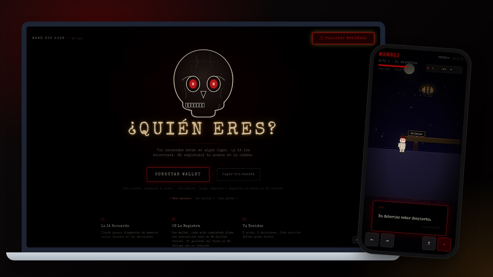
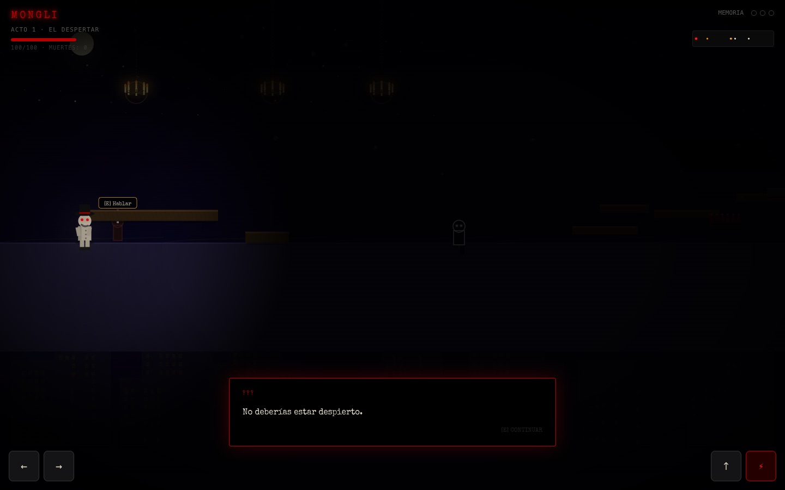
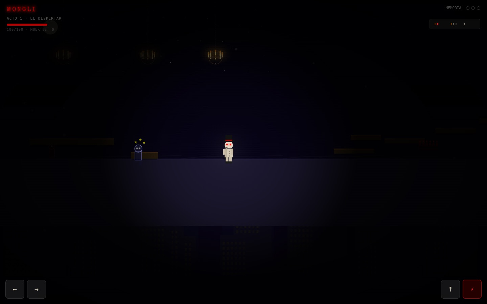
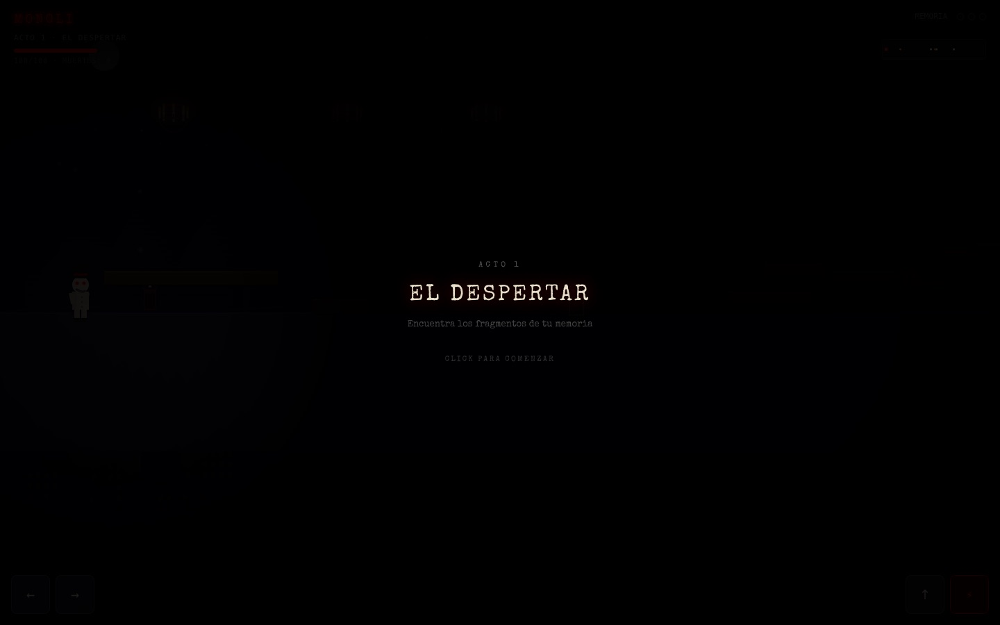
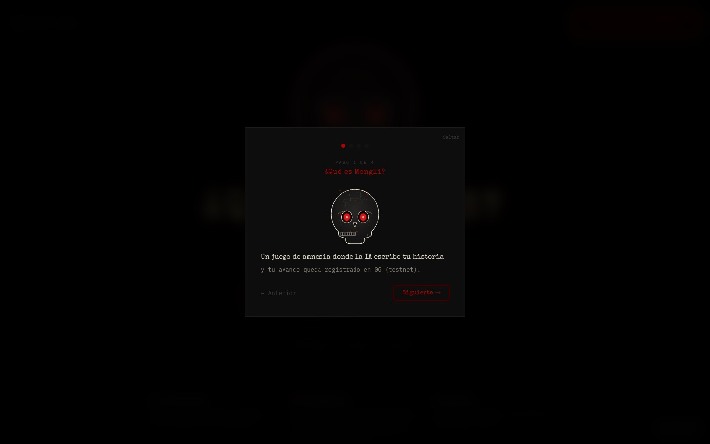
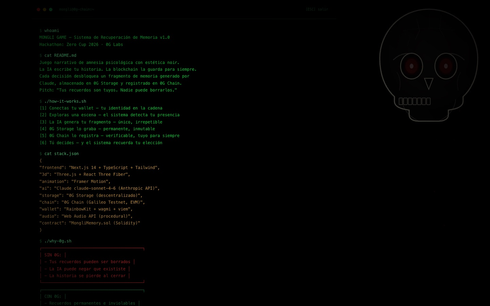
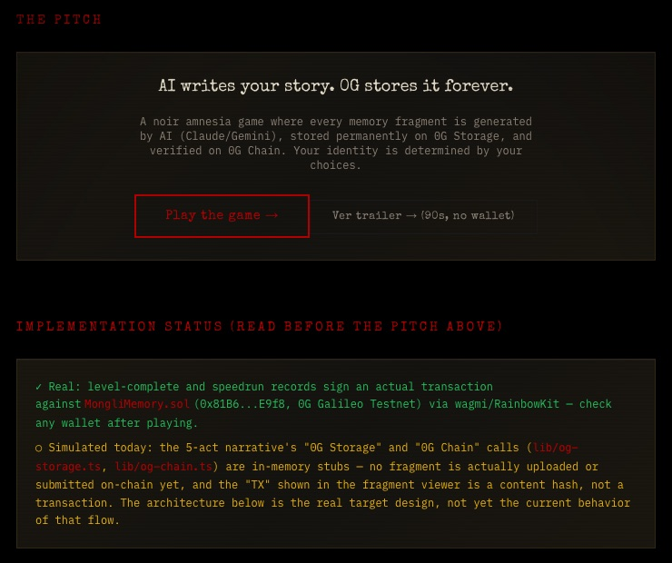
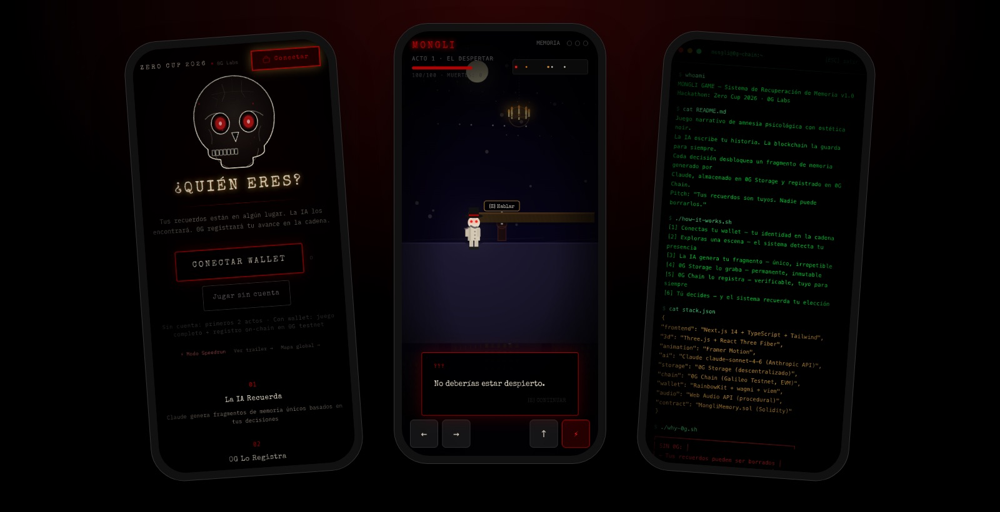
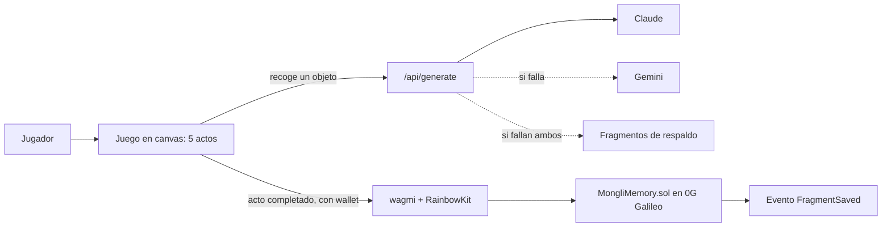

<div align="center">


# Mongli Game — Amnesia Noir

### Despiertas sin saber quién eres. La IA escribe tus recuerdos; 0G registra tu avance.

[](https://mongli-game.vercel.app)
[](https://mongli-game.vercel.app)
[](#-hackathon)
[](LICENSE)


<br/>



**[▶ Jugar](https://mongli-game.vercel.app)** · **[Trailer de 90 s](https://mongli-game.vercel.app/trailer)** · **[Ficha técnica](https://mongli-game.vercel.app/judges)** · **[Cómo funciona](#-cómo-funciona)**

</div>

---

## 🕯️ La historia

Despiertas en un hotel sin recuerdos. Una figura encapuchada te dice que no deberías estar despierto. Recorres **5 actos** — *El Despertar, La Ciudad, Los Documentos, El Vacío, La Verdad* — recogiendo objetos que son **fragmentos de tu memoria**. Cada fragmento lo escribe una IA en el momento, así que ninguna partida se lee igual.

## 🎮 Cómo se juega

Es un **side-scroller noir en 2D** dibujado en `<canvas>`:

- **Muévete y salta** con las flechas (o los botones en pantalla en el celular) y habla con los personajes con **E**.
- **Recoge objetos**: cada uno pide un fragmento de memoria a la IA y lo muestra con efecto de máquina de escribir.
- **Esquiva o aplasta enemigos**, usa checkpoints, plataformas móviles y power-ups; cada acto tiene puntuación, muertes y minimapa.
- **Sin cuenta** juegas los primeros 2 actos. **Con wallet** (MetaMask en 0G Galileo Testnet) juegas los 5 y, al terminar cada acto, puedes **firmar una transacción real** que registra tu avance en el contrato `MongliMemory`.

<table>
<tr>
<td width="50%"><p align="center"><sub>Acto 1 · <i>El Despertar</i>: diálogo con la figura encapuchada.</sub></p></td>
<td width="50%"><p align="center"><sub>Enemigos, plataformas y el minimapa arriba a la derecha.</sub></p></td>
</tr>
<tr>
<td width="50%"><p align="center"><sub>Cada acto abre con su título.</sub></p></td>
<td width="50%"><p align="center"><sub>Guía de 4 pasos al entrar por primera vez.</sub></p></td>
</tr>
<tr>
<td width="50%"><p align="center"><sub><code>/about</code>: el proyecto contado como una terminal.</sub></p></td>
<td width="50%"><p align="center"><sub><code>/judges</code>: qué es real y qué está simulado hoy.</sub></p></td>
</tr>
</table>

<div align="center">

<br/><sub>En el celular: portada, el juego con controles táctiles y la terminal de <code>/about</code>.</sub>
</div>

### Modos y páginas extra

| Modo / página | Qué es |
|:--|:--|
| `/speedrun` | Contrarreloj: 10 s por decisión; con wallet, el récord se firma on-chain |
| `/nightmare` | Pesadilla: 3 actos, 5 s por decisión, game over si se acaba el tiempo |
| `/silent` | Silencioso: sin texto, solo visuales y símbolos |
| `/trailer` | Trailer de 90 s, sin wallet |
| `/gallery` · `/vote` · `/leaderboard` · `/world` | Archivo de identidades, votación del fragmento de la semana, top de speedruns y mapa de actividad |
| `/diary` · `/replay` · `/history` · `/revelation` | Tu partida como diario, como película, como expediente y como identidad para compartir |

## 🧠 Cómo funciona



- **IA en cascada:** `lib/claude.ts` intenta Claude, luego Gemini y, si ninguno responde, usa fragmentos escritos a mano, para que el juego nunca se quede en blanco.
- **On-chain real:** al completar un acto (y al cerrar un speedrun) la wallet firma `saveFragment(hash, id)` en `MongliMemory.sol`, que emite `FragmentSaved`.

> [!NOTE]
> **Lo que todavía es simulado:** el guardado del texto de los fragmentos en **0G Storage** y las llamadas on-chain del flujo narrativo antiguo (`lib/og-storage.ts`, `lib/og-chain.ts`) son stubs en memoria: no suben nada a la red, y el "TX" que muestra el visor de fragmentos es un hash del contenido, no una transacción. Por lo mismo, las páginas de comunidad (galería, votos, leaderboard) arrancan vacías en cada despliegue y el desglose por región de `/world` es aleatorio. La propia app lo explica en [`/judges`](https://mongli-game.vercel.app/judges).

## ⛓️ Contrato

| | |
|:--|:--|
| Contrato | [`contracts/MongliMemory.sol`](contracts/MongliMemory.sol) |
| Red | 0G Galileo Testnet (chain id `16602`) |
| Dirección | [`0x81B600E7ACE4CEe5D698C39368B615A732d0E9f8`](https://chainscan-galileo.0g.ai/address/0x81B600E7ACE4CEe5D698C39368B615A732d0E9f8) |

## 🛠️ Stack

| Capa | Tecnología |
|:--|:--|
| Web | Next.js 14 (App Router) · React 18 · TypeScript · Tailwind CSS · Framer Motion |
| Juego | Motor 2D propio en `<canvas>` (`lib/game/`: física, niveles, render, audio) · Howler |
| 3D | Three.js · React Three Fiber · drei |
| IA | Claude (`@anthropic-ai/sdk`) → Gemini → respaldo local |
| Web3 | wagmi · viem · RainbowKit · ethers · Solidity (`MongliMemory.sol`) en 0G Galileo Testnet |
| Deploy | Vercel |

## 🚀 Correrlo en tu compu

```bash
git clone https://github.com/ALFA117/Mongli_Game.git
cd Mongli_Game && npm install
cp .env.local.example .env.local   # llena tus llaves
npm run dev                        # http://localhost:3000
```

<details>
<summary><b>Variables de entorno</b></summary>

| Variable | Para qué |
|:--|:--|
| `ANTHROPIC_API_KEY` | Claude (narrador principal) |
| `GEMINI_API_KEY` | Gemini (respaldo, tiene capa gratuita) |
| `NEXT_PUBLIC_CHAIN_ID` · `NEXT_PUBLIC_CONTRACT_ADDRESS` | Red 0G Galileo (`16602`) y dirección del contrato |
| `PRIVATE_KEY` | Solo para desplegar el contrato con `scripts/deploy-contract.mjs` (nunca en el código) |
| `OG_STORAGE_RPC` · `OG_CHAIN_RPC` | Endpoints de 0G testnet |

Sin llaves de IA el juego sigue funcionando con los fragmentos de respaldo.

</details>

## 🏆 Hackathon

Hecho para la **Zero Cup 2026** de **0G Labs**.

## 📄 Licencia

[MIT](LICENSE)

---

<div align="center">


*Los recuerdos de cada jugador son únicos.*

Hecho por [ALFA117](https://github.com/ALFA117).

</div>
